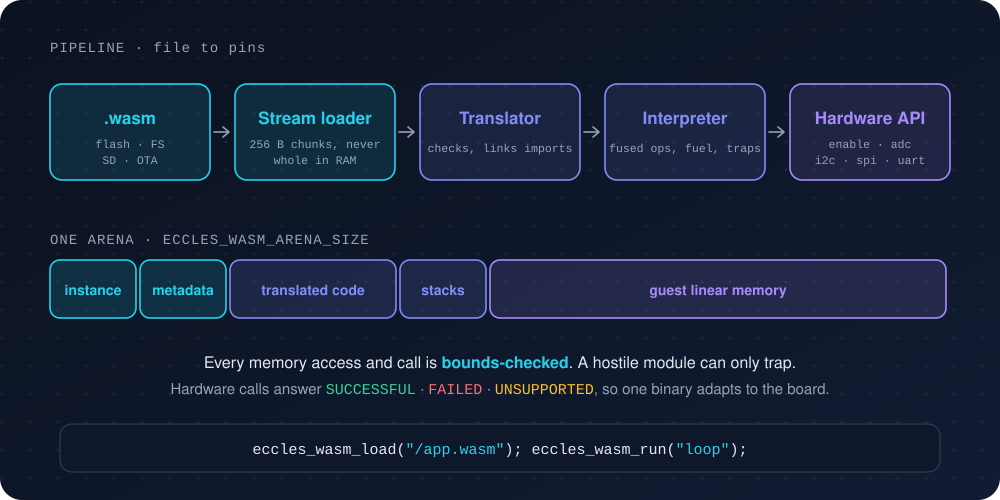

<div align="center">



<br>

[](https://github.com/igwe-starking/eccles-wasm/actions/workflows/ci.yml)
[](LICENSE)
[](#)
[](#)
[](CHANGELOG.md)
[](#-where-it-runs)
[](https://github.com/sponsors/igwe-starking)

### Flash your firmware once. Change what it does by dropping in a file.

**Eccles WASM** is a plain-C99 WebAssembly runtime for microcontrollers.
One header, one `.c`, no heap required, and the same `.wasm` runs on every chip.

<sub>Part of the **EcclesRTLib** family of embedded runtime libraries. Pairs with <a href="https://github.com/igwe-starking/eccles-rtmem"><b>eccles-rtmem</b></a>, the fixed-pool allocator.</sub>

[**Features**](#-what-you-get) · [**Quick start**](#-quick-start-30-seconds) · [**Use it on your MCU**](#-use-it-on-your-mcu) · [**Getting started guide**](docs/GETTING_STARTED.md) · [**How it works**](#-how-it-works) · [**Sponsor**](#-support-the-project)

</div>

---

## 😩 The firmware update you keep dreading

You want to tweak a blink pattern, a sensor threshold or a control loop. So you rebuild, reflash, and pray the OTA doesn't brick the device in the field. Or you want users to write their own plugins, and now you are one buffer overflow away from handing them your whole chip.

Eccles WASM puts a **sandboxed virtual machine** on the chip instead. Your firmware stays put. The behaviour lives in a small `.wasm` file you can swap over the air, from an SD card, or from flash, and a buggy or hostile module can only trap. It cannot touch the host.

```c
#include "eccles_wasm.h"

eccles_wasm_load("/spiffs/app.wasm");   // streamed from the filesystem in small chunks
eccles_wasm_run("setup");               // the guest can now blink pins, read ADCs, talk I²C ...
for (;;) eccles_wasm_run("loop");
```

## ✨ What you get

| | |
|---|---|
| 🧩 **Drop-in** | Copy `eccles_wasm.h` + `eccles_wasm.c`. Plain C99, zero dependencies, no linker scripts, no build-system lock-in. |
| 🔒 **Sandboxed by construction** | Every memory access, table access and call is bounds-checked at run time. A hostile module cannot read host RAM, overflow the stacks or escape. It can only trap. |
| ⛽ **Fuel limits** | `eccles_wasm_set_fuel(n)` makes a runaway guest trap instead of tripping your watchdog. |
| 🌊 **Streaming loader** | Modules are read in small chunks (256 B by default) from a file, SD card, flash driver, UART or OTA stream. The file is never held in RAM whole. |
| 🔌 **One hardware API, every chip** | `enable` `disable` `toggle` `analog` `pwm` `adc` `dac` `sleep` `millis` `irq_*` `uart_*` `i2c_*` `spi_*` and more, with the same names on every board. |
| 🎯 **Honest status codes** | Every call answers `SUCCESSFUL`, `FAILED` or `UNSUPPORTED`. A guest can probe what the board has and adapt, so one binary survives many boards. |
| 🦀 **Write guests in C, C++ or Rust** | Ready-made guest SDKs in [`sdk/`](sdk). The Rust crate implements `embedded-hal` 1.0, so existing driver crates run unmodified inside the module. |
| 🧵 **Many modules at once** | `eccles_wasm_vm_create()` gives independent instances that share nothing, so they run in parallel on different RTOS tasks or cores. |
| 🚀 **Fast for an interpreter** | Computed-goto dispatch plus fused instructions: up to **4× faster** than the plain-switch build ([numbers](#-speed)). |
| 🧠 **Modern WebAssembly** | 1.0 core plus sign-extension, saturating conversions, bulk memory, multi-value, reference types, tail calls, extended-const, imported memory/table/globals. |
| 🧱 **Your own imports** | `eccles_wasm_register("name", fn, "i(ii)")` exposes any C function of yours to the guest. |
| 📁 **Any filesystem** | stdio, FatFs, LittleFS, SPIFFS, SD, Zephyr `fs`, or your own three hooks. |
| 🧪 **Tested like it matters** | Differential fuzzing against Node/V8, sanitizers, thread tests, 5 build configurations, and hostile-module chaos tests. |

## ⚡ Quick start (30 seconds)

No hardware needed. The host build runs your module against a simulated chip:

```bash
make test examples
build/example_host examples/blink.wasm
```

```
loaded: 7 functions, 150 bytes of translated code, arena 68976/1046880 bytes
eccles_wasm guest up
  [gpio] pin 2 -> 1
  [gpio] pin 2 -> 0
loop() took 1000 ms of (simulated) time
  [gpio] pin 13 -> 1
  [gpio] pin 13 -> 0
  [gpio] pin 13 -> 1
  [gpio] pin 13 -> 0
blink(13, 2) -> status 0
```

Then on your own project:

1. Copy `src/eccles_wasm.h` and `src/eccles_wasm.c` into your tree (add the `.c` to your build).
2. Tell it how much RAM it may use: `-DECCLES_WASM_ARENA_SIZE=98304` or `-DECCLES_WASM_TOTAL_RAM_SIZE=...`.
3. `eccles_wasm_load(...)`, then `eccles_wasm_run("setup")`. That's it.

New to this? The [**getting started guide**](docs/GETTING_STARTED.md) walks through writing a guest, compiling it, and putting it on a board, step by step.

## ✍️ Writing the guest

The guest is the program that runs *inside* the sandbox. Use the SDK in [`sdk/`](sdk):

```c
#include "eccles_wasm_runtime.h"                                    /* sdk/c */
EW_EXPORT("setup") void setup(void) { ew_pin_mode(2, EW_OUTPUT); ew_printf("up at %u ms\n", (unsigned)ew_millis()); }
EW_EXPORT("loop")  void loop(void)  { ew_toggle(2); ew_sleep(500); }
```
```sh
clang --target=wasm32 -O2 -nostdlib -ffreestanding -Wl,--no-entry -Wl,-z,stack-size=4096 \
      -Wl,--initial-memory=65536 -Isdk/c -o app.wasm app.c
```
```rust
#![no_std]
use eccles_wasm_runtime::{println, Pin, sleep_ms};                  // sdk/rust
#[no_mangle] pub extern "C" fn setup() { println!("hello"); let _ = Pin(2).output(); }
#[no_mangle] pub extern "C" fn tick()  { let _ = Pin(2).toggle(); sleep_ms(500); }
```

`#define EW_ARDUINO_COMPAT` first and `pinMode`, `digitalWrite`, `analogRead`, `delay` and `millis` work exactly like Arduino. C++ gets `ew::Pin`, `ew::I2c` and `ew::Spi` with no exceptions, RTTI or heap. Full import list and details: [docs/RUNTIME_API.md](docs/RUNTIME_API.md).

## 🔧 How it works



The translator checks structure, resolves branches into relative jumps and tracks operand-stack height statically, so the interpreter stays small and never tracks block heights at run time. Everything the instance needs (stacks, tables, the guest's linear memory) lives in **one arena** you size at compile time. Design notes: [docs/DESIGN.md](docs/DESIGN.md).

## 🌍 Use it on your MCU

Pick your platform. Each backend is auto-selected at compile time, and every hardware call it cannot do answers `UNSUPPORTED` instead of guessing. Full walkthroughs, pin numbering and troubleshooting: [docs/GETTING_STARTED.md](docs/GETTING_STARTED.md).

<details open>
<summary><b>Arduino (ESP32, and any Arduino board with enough RAM)</b> · battle-tested</summary>

Install as a library (**Sketch → Include Library → Add .ZIP Library**, or clone into `libraries/`). Embed the module as an array (`xxd -i app.wasm > app_wasm.h`) or stream it from LittleFS, SPIFFS or SD:

```cpp
#include <LittleFS.h>
#include <Wire.h>
#include <eccles_wasm.h>

void setup() {
  Serial.begin(115200);
  LittleFS.begin(true);
  eccles_wasm_use_serial(Serial);          // guest log() and printf -> Serial
  eccles_wasm_use_wire(Wire);              // guest i2c_* -> Wire (bus 0)

  File f = LittleFS.open("/app.wasm");     // streamed ECCLES_WASM_CHUNK_SIZE bytes at a time
  if (eccles_wasm_load(f) != ECCLES_WASM_SUCCESSFUL) {
    Serial.printf("load failed: %s\n", eccles_wasm_error_name(eccles_wasm_last_error()));
    return;
  }
  f.close();
  eccles_wasm_run("setup");
}

void loop() { eccles_wasm_run("loop"); }
```

No filesystem? `eccles_wasm_load_buffer(app_wasm, app_wasm_len)` runs it straight from flash with zero copy. Complete sketch: [`examples/arduino_esp32_littlefs`](examples/arduino_esp32_littlefs).
</details>

<details>
<summary><b>ESP32 with ESP-IDF</b></summary>

Copy this repo into your project's `components/` folder (the included `CMakeLists.txt` registers it). Set `ECCLES_WASM_ARENA_SIZE` in `eccles_wasm_config.h` (default is a 96 KB heap block), mount SPIFFS/LittleFS/FAT/SD, and:

```c
#include "eccles_wasm.h"

void app_main(void) {
    eccles_wasm_load("/spiffs/app.wasm");        // or eccles_wasm_load_buffer(array, len)
    eccles_wasm_set_fuel(2000000);               // a runaway guest traps instead of tripping the task watchdog
    eccles_wasm_run("setup");
    for (;;) eccles_wasm_run("loop");
}
```

PWM uses LEDC, ADC needs IDF 5 or newer. Example: [`examples/esp_idf`](examples/esp_idf).
</details>

<details>
<summary><b>Raspberry Pi Pico (RP2040 / RP2350)</b></summary>

Add `src/eccles_wasm.c` to your CMake target and link `pico_stdlib hardware_gpio hardware_adc hardware_pwm hardware_i2c hardware_spi hardware_uart hardware_watchdog pico_rand`. Embed the module as an array, or put a FatFs port on the include path and `eccles_wasm_load("0:/app.wasm")` switches on automatically. Example: [`examples/pico`](examples/pico).
</details>

<details>
<summary><b>STM32 (HAL / CubeMX)</b></summary>

Add `src/eccles_wasm.c`, then create `eccles_wasm_config.h` beside the header with your RAM size and the CubeMX handles:

```c
#include "main.h"
extern UART_HandleTypeDef huart2;  extern I2C_HandleTypeDef hi2c1;  extern SPI_HandleTypeDef hspi1;
#define ECCLES_WASM_TOTAL_RAM_SIZE      (128ul * 1024ul)
#define ECCLES_WASM_MEM_LIMIT_BYTES     (16ul * 1024ul)    /* guest memory actually backed */
#define ECCLES_WASM_STM32_UART_HANDLES  { &huart2 }
#define ECCLES_WASM_STM32_I2C_HANDLES   { &hi2c1 }
#define ECCLES_WASM_STM32_SPI_HANDLES   { &hspi1 }
```

Pins are `port*16 + bit` (PA5 = 5, PB0 = 16, PC13 = 45). Example: [`examples/stm32_cubemx`](examples/stm32_cubemx).
</details>

<details>
<summary><b>Zephyr / nRF Connect SDK (nRF52, nRF53, ...)</b></summary>

In `prj.conf` set `CONFIG_REBOOT=y` and `CONFIG_ENTROPY_GENERATOR=y` (plus `CONFIG_FILE_SYSTEM=y` and a mounted filesystem if you load by path). Add the source to your app, then `eccles_wasm_load_buffer(...)` or `eccles_wasm_load("/path")`. Pins are `port*32 + bit`. Example: [`examples/zephyr`](examples/zephyr).
</details>

<details>
<summary><b>Any other chip</b></summary>

Fill only the hardware functions you have into an `eccles_wasm_hal_t` and call `eccles_wasm_hal_override()`. Everything you leave out answers `UNSUPPORTED`. For files, `eccles_wasm_set_fs(open, read, close)` plugs in any filesystem, or use `eccles_wasm_load_stream()` for SD cards, flash drivers, UART or OTA.
</details>

<details>
<summary><b>Your PC (simulator)</b></summary>

`make` builds a `wsrun` CLI that runs any module against a simulated chip, so you can develop and test guests with no board attached. See [`examples/host`](examples/host).
</details>

### How much RAM do I need?

A stock clang or rustc module declares one 64 KiB wasm page, so a full instance needs about **64 KiB + code + ~3 KiB of stacks**. Smaller chips can back only part of it:

| Free RAM | What to do |
|---|---|
| **128 KB or more** (ESP32, RP2040, STM32F4/H7, nRF52840, SAMD51) | Stock modules, defaults work. |
| **~32 to 128 KB** (STM32L4, SAMD21, nRF52832) | Set `ECCLES_WASM_MEM_LIMIT_BYTES` so only the first N bytes are backed (accesses above N trap), and link the guest with a small stack (`-z stack-size=2048`). |
| **Under ~24 KB** (classic AVR, MSP430, 8051) | Not a target. The build stops with a clear `#error`. |

Give it your chip's RAM with `ECCLES_WASM_TOTAL_RAM_SIZE` and the arena is chosen for you (the smaller of half your RAM or 24 KB + a quarter of it), or set `ECCLES_WASM_ARENA_SIZE` yourself. For anything you ship, set it explicitly.

## 🗺️ Where it runs

| Backend | Selected when | GPIO | ADC | PWM | time/sleep | reset | RNG | IRQ | UART | I²C | SPI | log |
|---|---|---|---|---|---|---|---|---|---|---|---|---|
| Host simulator | Linux/macOS/Windows | sim | sim | sim | ✓ | sim | ✓ | sim | sim | sim | sim | stdout |
| **Arduino** (incl. ESP32) · tested | `ARDUINO` | ✓ | ✓ | ✓ (fixed freq) | ✓ | ESP32/Cortex-M | ESP32 | – | glue | glue | glue | glue |
| ESP-IDF (ESP32) | `ESP_PLATFORM` | ✓ | ✓ (IDF≥5) | ✓ (LEDC) | ✓ | ✓ | ✓ | ✓ | ✓ | ✓ | ✓ | stdout |
| Pico SDK | `PICO_BUILD` | ✓ | ✓ | ✓ | ✓ | ✓ | ✓ | ✓ | ✓ | ✓ | ✓ | stdout |
| STM32 HAL | `USE_HAL_DRIVER` | ✓ | – | – | ✓ | ✓ | – | – | CubeMX handle | CubeMX handle | CubeMX handle | – |
| Zephyr / nRF Connect | `__ZEPHYR__` | ✓ | – | – | ✓ | ✓ | ✓ | – | – | – | – | printk |
| anything else | – | plug in with `eccles_wasm_hal_override()` | | | | | | | | | | |

`–` returns `UNSUPPORTED` rather than guessing. Arduino's `Serial`, `Wire` and `SPI` are C++ classes, so you hand them over once: `eccles_wasm_use_serial(Serial); eccles_wasm_use_wire(Wire);`.

**Files:** stdio (host, ESP-IDF and Arduino-ESP32 VFS, mbed) · FatFs (when `ff.h` is found) · LittleFS · Zephyr `fs` · a `Stream`/`File` overload for Arduino SD, LittleFS and SPIFFS.

## 🧵 Instances and threads

`eccles_wasm_vm_create()` carves a complete instance (stacks, memory, error state, host functions) out of the arena you pass in. Instances share **nothing**, so different instances run truly in parallel on different tasks or cores with no locking inside the interpreter. The chip itself is shared: wrap pin and bus access with your RTOS mutex through `ECCLES_WASM_HW_LOCK()` and `ECCLES_WASM_HW_UNLOCK()` (the host build does it with pthreads via `-DECCLES_WASM_THREADSAFE`). One instance must be driven by one task at a time. Cost: about 1.7 KB of RAM per instance on a 64-bit host, less with 32-bit pointers. See [`examples/multi_instance`](examples/multi_instance).

## 🚀 Speed

Computed-goto dispatch (GCC and Clang; a portable `switch` elsewhere) plus fused instructions that the loader builds from the commonest compiled-code sequences (`local.get; local.get; i32.add`, compare + branch, `x = a op b` straight into a local, local-base loads). Measured on one x86-64 machine, `-O2`, best of 3, against the previous plain-`switch` build of this same runtime:

| benchmark | plain switch | switch + fusion | computed goto + fusion |
|---|---|---|---|
| recursive fib(34), 18 M calls | 374 ms | 201 ms | **145 ms** (2.6×) |
| 100 M-iteration i32 ALU loop | 3096 ms | 1236 ms | **765 ms** (4.0×) |
| 1 MB sieve (loads/stores) | 88 ms | 37 ms | **22 ms** (4.0×) |
| 50 M-iteration i64/f64 loop | 1631 ms | 1291 ms | **727 ms** (2.2×) |

Numbers come from one x86-64 host, measured against this project's earlier build. `tests/bench.sh` and `tests/bench_gen.py` let you run the same modules on your board. i64/f64 code is not fused yet. Computed goto helps most on cores with indirect-branch prediction, so on a Cortex-M0 to M4 expect a smaller gain than on x86.

## 🧠 What it runs

WebAssembly 1.0 core plus everything clang, rustc and AssemblyScript emit by default today: sign-extension, saturating float→int, bulk memory (`memory.copy/fill/init`, `data.drop`), multi-value, reference types (funcref/externref, multiple tables, `table.*`, all element-segment forms), tail calls, extended-const, mutable globals, and imported memory, table and globals. A minimal built-in WASI covers `fd_write`, `proc_exit`, `clock_time_get`, `random_get`, `args_*` and `environ_*`, so `printf` and `println!` code runs too.

**Not supported yet** (rejected at load, naming the opcode): SIMD (`v128`), threads/atomics, exception handling, GC, multiple memories, memory64. None is on by default in clang or rustc; a module needing one was built with an explicit flag (`-msimd128`, `+atomics`, `-fwasm-exceptions`). SIMD is the next milestone.

Validation is **structural**: indices, branch targets, block nesting and operand-stack height are checked at load, and every memory/table access and call is bounds-checked at run time. Operand *types* are not checked, so a mistyped module computes garbage rather than crashing the host (`make chaos` runs about 1 000 such modules under ASan and UBSan).

## 🧪 How it was tested

- **On hardware.** Battle-tested edge to edge on **Arduino** and **ESP32**.
- **Differential testing against Node/V8** (`make fuzz`): hand-written control-flow, memory, call, passive-segment, reference-type, element-form, tail-call, imported memory/table/global and extended-const modules; random typed numeric expression trees over every i32/i64/f32/f64 op; and random structured control flow (blocks, loops, `br_table`, valued branches over junk stack) that heavily exercises the fused instructions. About 13 000 to 19 000 calls compared per run, repeated over many seeds, also under ASan + UBSan. Injected interpreter, translator and fusion bugs were each caught. Not compared (non-deterministic by spec): NaN sign/payload of arithmetic results observed through `reinterpret`/`copysign`; and `memory.grow`/`table.grow` beyond the initial size, which this runtime refuses.
- **Unit tests** (`make test`, 5 configurations): hardware imports against the simulator, WASI, host functions, explicit instances, traps, fuel, limits, link errors, streaming, memory limit, `NO_FLOAT`, arena exhaustion, and 6 000 corrupted modules per run.
- **Threads** (`make tsan`): 12 instances on 6 threads under ThreadSanitizer. Without the hardware lock TSan reports the shared-pin races; with it, none.
- **Backend compile-checks** (`make mocks`): every hardware and file backend compiled with `-Werror` against stub SDK headers.
- **Guest SDKs** (`make sdk-check`, `make guests`): the C and Rust SDKs are verified against the runtime's import table, and the C and C++ guests are compiled to wasm32 with clang and run on the simulator.
- **CI** builds and tests with GCC and Clang, plus sanitizer and thread jobs, on every push and pull request.

## ✅ Honest trade-offs

I'd rather you pick the right tool than be surprised later.

- **It's an interpreter.** Expect it to be tens to hundreds of times slower than native code on an MCU. It is for logic, control loops and glue, not DSP inner loops.
- **Structural validation only.** Operand types are not checked (see above). Use toolchains you trust to emit valid wasm, and keep fuel limits on for untrusted modules.
- **Memory is fixed.** `memory.grow(0)` works; `grow(n>0)` returns -1.
- **Chips under ~24 KB of RAM are not targets.**

## 🗂️ Repository layout

```
src/eccles_wasm.h             API + documentation + configuration surface + Arduino/C++ helpers
src/eccles_wasm.c             loader, translator, interpreter, backends
config/eccles_wasm_config.h   commented template (picked up automatically via __has_include)
sdk/c  sdk/rust               the guest SDKs: C/C++ header and Rust crate
examples/                     host, Arduino, ESP-IDF, Pico, STM32, Zephyr, multi-instance, guest modules
tests/                        unit tests, differential fuzzer, thread and chaos tests, SDK mocks
docs/                         GETTING_STARTED, RUNTIME_API, DESIGN
```

## 🛠️ Development

```bash
make test         # unit tests in 5 configurations
make mocks        # compile-check every hardware backend
make sdk-check    # guest SDKs vs the runtime import table
make guests       # compile C/C++ guests to wasm32 and run them (needs clang + wasm-ld)
make fuzz         # differential test against Node (needs node + python3)
make tsan         # multi-instance thread test under ThreadSanitizer
make chaos        # type-confused modules under ASan + UBSan
make check        # test + mocks + examples + sdk-check + check-gen
```

## 🗺️ Roadmap

- [ ] SIMD (`v128`) support
- [ ] Option to drop the fused handlers on very small flash
- [ ] Fuse i64/f64 sequences

Want one of these? [Open an issue](../../issues) or a PR, see [CONTRIBUTING.md](CONTRIBUTING.md).

## 💖 Support the project

Eccles WASM is free, MIT-licensed and built in spare hours. If it saved you a reflash or let you ship a plugin system safely, consider sponsoring. It directly funds hardware for testing more chips.

<div align="center">

[**♥ Sponsor on GitHub**](https://github.com/sponsors/igwe-starking)

</div>

Can't sponsor? A ⭐ on the repo and telling one embedded developer who is tired of reflashing helps just as much.

## 🤝 Contributing

Bug reports, new platform backends and results from your board are especially welcome. Read [CONTRIBUTING.md](CONTRIBUTING.md) and follow the [Code of Conduct](CODE_OF_CONDUCT.md). Security issues: see [SECURITY.md](SECURITY.md).

## 📄 License

[MIT](LICENSE). Use it in hobby projects and products alike.
