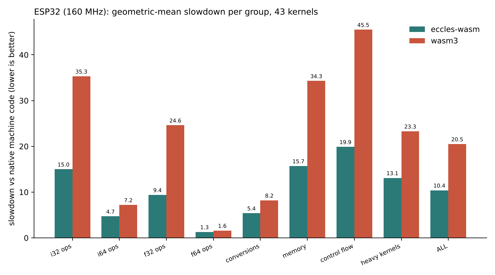

<div align="center">



<br>

[](https://github.com/igwe-starking/eccles-wasm/actions/workflows/ci.yml)
[](LICENSE)
[](#)
[](#)
[](CHANGELOG.md)
[](validation/)
[](#-the-benchmark)
[](ECCLES_WASM_WIKI.txt)
[](https://github.com/sponsors/igwe-starking)

### Flash your firmware once. Change what it does by dropping in a file.

**Eccles WASM** is a WebAssembly runtime for microcontrollers, written in plain C99.
Two files, no OS, no heap required. A module can touch **no hardware** until you say so.

<sub>Part of the **EcclesRTLib** family of embedded runtime libraries. Pairs with <a href="https://github.com/igwe-starking/eccles-rtmem"><b>eccles-rtmem</b></a>, the fixed-pool allocator.</sub>

[**Benchmark**](#-the-benchmark) · [**Proof**](#-proven-on-real-hardware) · [**Quick start**](#-quick-start) · [**Your MCU**](#-set-it-up-on-your-mcu) · [**Spawner**](#-need-threads-add-a-spawner) · [**set_fs**](#-need-to-load-from-a-file-add-eccles_wasm_set_fs) · [**Wiki**](#-the-wiki) · [**Support ♥**](#-support-the-project) · [**Troubleshooting**](#-when-something-goes-wrong)

</div>

---

## 🏁 The benchmark

A real ESP32 (rev 3.1, 160 MHz), 43 kernels, the same C source run as native code, in **Eccles WASM** and in **wasm3**. Every result had to match native exactly before a time counted.

<div align="center">

| | slower than native code | |
|---|---:|---|
| **Eccles WASM** | **10.4×** | ██████████ |
| wasm3 | 20.5× | ████████████████████ |

**Faster than wasm3 on all 43 of 43 kernels. About 2× faster overall. Identical checksums everywhere.**

</div>



| Kernel group | Eccles WASM | wasm3 | Eccles WASM is |
|---|---:|---:|---:|
| i32 | 15.0× | 35.3× | 2.3× faster |
| i64 | 4.7× | 7.2× | 1.5× faster |
| f32 | 9.4× | 24.6× | 2.6× faster |
| f64 | 1.3× | 1.6× | 1.2× faster |
| conversions | 5.4× | 8.2× | 1.5× faster |
| memory | 15.7× | 34.3× | 2.2× faster |
| control flow | 19.9× | 45.5× | 2.3× faster |
| heavy kernels (CRC, sort, matmul, sieve...) | 13.1× | 23.3× | 1.8× faster |
| **All 43** | **10.4×** | **20.5×** | **2.0× faster** |

Numbers are slowdown versus native machine code on the same chip (lower is better). Build: `-O2`, `ECCLES_WASM_FUEL 0`, `ECCLES_WASM_YIELD_INTERVAL 0`, interpreter loop in IRAM.

**Read this too.** On a PC (x86) wasm3 was 1.4× faster, so do not carry these numbers to another chip: measure on yours. f64 looks cheap because the ESP32 has no double-precision FPU, so native code is slow too. The method, all 43 kernels and the raw log are on the [benchmark page](wiki/Performance-and-Benchmarks.md), and you can re-run it from [`validation/02-benchmark-vs-wasm3`](validation/02-benchmark-vs-wasm3).

---

## ✅ Proven on real hardware

An ESP32 conformance run of **4186 checks: 4186 pass, 0 fail**, in 80 seconds, with the full serial log kept in the repo.

| Phase | What it checks |
|---|---|
| A Regression | GPIO, PWM, IRQ, ADC, UART, I2C, SPI, timing, i32/i64/f32/f64 edge arithmetic, SHA/ChaCha/primes |
| B Traps | 16 deliberate traps with exact codes, and the instance recovering; 504 float-to-int opcode cases |
| C Privileges | 51 policies × 44 imports × argument variants checked against an independent model; denied calls leave the hardware untouched |
| D Edge cases | 399 table cases on 51 hand-assembled modules, malformed modules included |
| E Atomics | All 1960 threads-proposal opcode cases, alignment and bounds traps, wait/notify |
| F Robustness | Truncation sweep and mutation fuzzing: the chip never crashed |
| G Speed | Native versus WebAssembly, bit-identical results |
| H Threads | Sibling instances on FreeRTOS tasks over one shared memory, on both cores |
| I Instances | Isolation, concurrent instances, create/destroy leak check |

On the PC the release source is also checked by differential fuzzing against Node's WebAssembly engine (912 modules, 17,465 calls, 0 mismatches; 163 atomics modules, 6,077 calls, 0 mismatches), ThreadSanitizer, and AddressSanitizer with UBSan over type-confused modules.

Details, the one known guest-check quirk, jumper wiring and how to run it yourself: [`validation/`](validation/) and the [Validation page](wiki/Validation.md). The firmware under `validation/` carries the earlier snapshot of the runtime that was flashed, with the same API as this release (see the note in [`validation/README.md`](validation/README.md)).

---

## ✨ What you get

| | |
|---|---|
| 🔒 **Deny by default** | A new module can compute and nothing else. You grant GPIO, buses, time, random, log, threads, by bit, and can limit it to chosen pins, buses and I2C addresses |
| 🧱 **Sandboxed** | Every memory access is bounds-checked. A hostile module traps. It cannot touch your firmware |
| ⏱️ **Fuel** | A per-call instruction budget stops runaway loops |
| 📦 **Two files** | `eccles_wasm.h` and `eccles_wasm.c`. Plain C99, zero dependencies |
| 🧠 **Arena based** | One fixed block you size yourself. No `malloc` unless you ask |
| 🌊 **Streaming loader** | Loads from a file in 256-byte pieces. The module never needs to fit in RAM |
| 🧵 **Optional threads** | wasi-threads and atomics, with a spawner you write in a few lines |
| 🗂️ **Any file source** | Built-in stdio, FatFs, LittleFS, Zephyr fs, Arduino `Stream`, or your own with `eccles_wasm_set_fs` |
| 🧩 **Many instances** | Each with its own memory, privileges and host functions |
| 🔌 **Host functions** | Give modules your own C functions in one line |
| 🧰 **Guest SDKs** | C and C++ header (`ew_*`, `ew::Pin`, `ew::I2c`, `ew::Spi`, Arduino-style names) and a `no_std` Rust crate with `embedded-hal` 1.0 |
| 🌍 **Six backends** | Arduino, ESP-IDF, Pico, STM32 HAL, Zephyr/nRF, desktop simulator, and a way to add any other chip |
| 🏎️ **Fast** | Computed-goto dispatch, fused instructions, optional loop in internal RAM |
| 📚 **Documented to the last function** | A 37-page wiki and a single-file text version, with examples that are built and run |

**WebAssembly supported:** core 1.0, sign-extension, saturating conversions, bulk memory, multi-value, reference types, tail calls, extended constants, mutable globals, imported memory/tables/globals, minimal WASI, and (optional) atomics and wasi-threads. **Not supported:** SIMD, exception handling, GC, multiple memories, 64-bit memory.

---

## 🚀 Quick start

**Step 1. Run it on your PC.** Needs `git`, `make` and a C compiler.

```bash
git clone https://github.com/igwe-starking/eccles-wasm
cd eccles-wasm
make examples
build/example_host examples/blink.wasm
```

**Step 2. Write a module.** A module is a C program compiled for `wasm32` with clang (`sudo apt install clang lld`).

```c
// blink.c
#include "eccles_wasm_runtime.h"

EW_EXPORT("setup") void setup(void) { ew_enable(2); }
EW_EXPORT("loop")  void loop(void)  { ew_toggle(2); ew_sleep(500); }
```

```bash
clang --target=wasm32 -O2 -nostdlib -ffreestanding \
  -Wl,--no-entry -Wl,--export-all -Wl,-z,stack-size=4096 -Wl,--initial-memory=65536 \
  -Isdk/c -o blink.wasm blink.c
```

**Step 3. Run it from C.**

```c
#include "eccles_wasm.h"

int main(void) {
    eccles_wasm_init();
    eccles_wasm_set_hal_privilege(ECCLES_WASM_ALLOW_PIN_ALL | ECCLES_WASM_ALLOW_SAFE);  // what the module may touch
    if (eccles_wasm_load("blink.wasm") != ECCLES_WASM_SUCCESSFUL) return 1;              // stream it in
    eccles_wasm_run("setup");
    for (;;) eccles_wasm_run("loop");
}
```

```bash
gcc -std=c99 -O2 -Isrc app.c src/eccles_wasm.c -o app -lm
```

**Step 4. Put it on a board.** Embed the module as a C array and load it from memory:

```bash
python3 tools/wasm2c.py blink.wasm blink_wasm.h blink_wasm
```

```c
eccles_wasm_load_buffer(blink_wasm, blink_wasm_len);
```

Full walk-through with real output: [Quick Start](wiki/Quick-Start.md).

### Two ways to structure a module

`setup` and `loop` (above) is the default: the host calls `loop` repeatedly and keeps control between calls, so it can feed a watchdog, service the network, or swap modules. For a dedicated device you can instead export a single `main` that loops inside the module and call `eccles_wasm_run("main")` once. That removes the per-iteration host call and keeps state in local variables, but `run` then blocks, so leave fuel at 0, sleep inside the loop, and use a stop flag if the host must end it. Details: [Concepts](wiki/Concepts.md) and [Stop or swap a running main](wiki/Cookbook.md).

### The privilege line

Without `eccles_wasm_set_hal_privilege(...)` every hardware call from the module returns `DENIED` (3) and the pin does nothing. That is the single most common reason for "it loads but nothing happens". Presets: `ALLOW_NONE`, `ALLOW_SAFE` (time, random, log), `ALLOW_READ_ONLY`, `ALLOW_PIN_ALL`, `ALLOW_BUSES`, `ALLOW_ALL`. Individual bits: `ECCLES_WASM_PERM_GPIO_READ`, `_GPIO_WRITE`, `_I2C`, `_SPI`, `_UART`, `_ADC`, `_THREADS` and more. See [Permissions](wiki/Permissions.md).

---

## 🔌 Set it up on your MCU

Pick your chip, follow its page, copy the example. Each page has install, a complete project, pin numbering, board notes and a table of problems.

| Chip | Page | Pin numbers | Tested |
|---|---|---|---|
| **Arduino** (ESP32, Nano 33 BLE, RP2040, Uno R4, SAMD51, Teensy) | [Platform-Arduino](wiki/Platform-Arduino.md) | the Arduino pin | ESP32, Nano 33 BLE |
| **ESP32 / ESP-IDF** | [Platform-ESP-IDF](wiki/Platform-ESP-IDF.md) | GPIO number | ESP32 hardware, 4186 checks |
| **Raspberry Pi Pico / RP2040** | [Platform-Raspberry-Pi-Pico](wiki/Platform-Raspberry-Pi-Pico.md) | GP number | backend compile-checked |
| **STM32** (HAL / CubeMX) | [Platform-STM32](wiki/Platform-STM32.md) | `port*16 + bit` | backend compile-checked |
| **Zephyr, nRF Connect** | [Platform-Zephyr-and-nRF](wiki/Platform-Zephyr-and-nRF.md) | `port*32 + bit` | backend compile-checked |
| **Any other chip** | [Platform-Other-MCUs](wiki/Platform-Other-MCUs.md) | your own | `eccles_wasm_hal_override` |
| **PC simulator** | [Platform-Desktop-Simulator](wiki/Platform-Desktop-Simulator.md) | virtual | `make check` |

Not sure it works on your board? Run the portable **bring-up checklist**, five stages from "compiles" to "the module drives a pin": [Bring-Up Checklist](wiki/Bring-Up-Checklist.md).

### Arduino, copy and paste

```cpp
#include <eccles_wasm.h>
#include "app_wasm.h"                      // made by tools/wasm2c.py

void setup() {
  Serial.begin(115200);
  eccles_wasm_use_serial(Serial);          // the module's ew_printf goes to Serial
  eccles_wasm_set_hal_privilege(ECCLES_WASM_ALLOW_PIN_ALL | ECCLES_WASM_ALLOW_SAFE);
  if (eccles_wasm_load_buffer(app_wasm, app_wasm_len) != ECCLES_WASM_SUCCESSFUL) {
    Serial.println(eccles_wasm_error_name(eccles_wasm_last_error()));
    return;
  }
  eccles_wasm_run("setup");
}

void loop() { eccles_wasm_run("loop"); }
```

### ESP-IDF, copy and paste

```c
#include "eccles_wasm.h"
#include "blink_wasm.h"

void app_main(void) {
    eccles_wasm_init();
    eccles_wasm_set_hal_privilege(ECCLES_WASM_ALLOW_PIN_ALL | ECCLES_WASM_ALLOW_SAFE);
    if (eccles_wasm_load_buffer(blink_wasm, blink_wasm_len) != ECCLES_WASM_SUCCESSFUL) return;
    eccles_wasm_run("setup");
    for (;;) eccles_wasm_run("loop");
}
```

Set `CONFIG_ESP_MAIN_TASK_STACK_SIZE=16384` in `sdkconfig.defaults`. Complete projects for every platform are in [`examples/`](examples/).

---

## 🧵 Need threads? Add a spawner

Threads are optional. When a module starts its own threads (wasi-threads), the runtime does not create them. **You give it one function that starts an RTOS task**, and it does the rest.

1. Build with `-DECCLES_WASM_ATOMICS=1 -DECCLES_WASM_THREADS=1`.
2. Grant `ECCLES_WASM_PERM_THREADS`.
3. Register a spawner. It creates a sibling with `eccles_wasm_vm_spawn`, starts a task, and the task calls `eccles_wasm_vm_thread_start` and then `eccles_wasm_vm_destroy`.

```c
typedef struct { eccles_wasm_vm_t *vm; void *arena; int32_t tid; uint32_t arg; } child_t;
static int32_t g_next_tid = 1;

static void child_main(void *p) {                    // body of the new task (FreeRTOS: void fn(void *))
    child_t *c = (child_t *)p;
    eccles_wasm_vm_thread_start(c->vm, c->tid, c->arg);   // runs the module's wasi_thread_start
    eccles_wasm_vm_destroy(c->vm);                        // always destroy the child when it ends
    free(c->arena); free(c);
    // vTaskDelete(NULL);                                 // FreeRTOS: end the task
}

static int32_t my_spawner(eccles_wasm_vm_t *parent, uint32_t start_arg, void *ctx) {
    child_t *c = malloc(sizeof *c);
    c->arena = malloc(48 * 1024);                                           // each child needs its own arena
    c->vm = eccles_wasm_vm_spawn(parent, c->arena, 48 * 1024);              // shares code, memory, privileges
    if (!c->vm) { free(c->arena); free(c); return -1; }                     // -1 = refuse
    c->tid = g_next_tid++; c->arg = start_arg;
    // xTaskCreate(child_main, "wasm", 8192, c, 5, NULL);                  // your RTOS call goes here
    return c->tid;
}

// once, at start-up:
eccles_wasm_vm_set_hal_privilege(vm, ECCLES_WASM_PERM_THREADS | ECCLES_WASM_PERM_TIME);
eccles_wasm_vm_set_thread_spawner(vm, my_spawner, NULL);
```

The parent instance must outlive its children. A complete runnable version (POSIX threads), a FreeRTOS version that compile-checks against stubs, the guest side, and the hardware lock for shared pins are on the [Threads and Spawner](wiki/Threads-and-Spawner.md) page. Without a spawner, `thread-spawn` just returns -1 to the module.

---

## 📂 Need to load from a file? Add `eccles_wasm_set_fs`

`eccles_wasm_load("/path")` works by itself on stdio (host, ESP-IDF, mbed), FatFs, LittleFS and Zephyr fs, and Arduino can load from any `File` or `Stream`. When your module sits somewhere else (a raw flash partition, an SD card with your own driver, an encrypted store), give the runtime three functions:

```c
static void *my_open(const char *path)                     { /* return a handle, or NULL */ }
static int   my_read(void *f, uint8_t *buf, size_t max)    { /* return bytes read, 0 at the end, <0 on error */ }
static void  my_close(void *f)                             { /* release the handle */ }

eccles_wasm_set_fs(my_open, my_read, my_close);            // once, at start-up
eccles_wasm_load("anything");                              // the string is handed to my_open unchanged
```

Runnable RAM-disk example, FatFs, LittleFS, stdio and a raw flash partition recipe: [Custom Filesystems](wiki/Custom-Filesystems.md).

---

## 🔌 Give modules your own functions

```c
static eccles_wasm_status_t host_scale(eccles_wasm_vm_t *vm, uint64_t *slots) {
    (void)vm;
    slots[0] = eccles_wasm_from_i32(eccles_wasm_to_i32(slots[0]) * 3);   // result goes back in slot 0
    return ECCLES_WASM_SUCCESSFUL;
}

eccles_wasm_register("host_scale", host_scale, "i(i)");    // before load: result i32, one i32 argument
```

Pointers, strings and buffers, per-instance state, and a worked sensor example: [Host Functions](wiki/Host-Functions.md).

---

## 📖 The wiki

The documentation lives in [`wiki/`](wiki/) (ready to publish as a GitHub wiki) and as **one text file**, [`ECCLES_WASM_WIKI.txt`](ECCLES_WASM_WIKI.txt). Every public function is documented, every example is built and run by CI, and the pages are written to be copied from.

| Start | Use it | Reference | Proof |
|---|---|---|---|
| [Home](wiki/Home.md) | [Writing Guests](wiki/Writing-Guests.md) | [Host API](wiki/Host-API-Reference.md) | [Performance and Benchmarks](wiki/Performance-and-Benchmarks.md) |
| [Quick Start](wiki/Quick-Start.md) | [Guest Import Reference](wiki/Guest-Import-Reference.md) | [Configuration](wiki/Configuration-Reference.md) | [Validation](wiki/Validation.md) |
| [Concepts](wiki/Concepts.md) | [Loading Modules](wiki/Loading-Modules.md) | [Memory Sizing](wiki/Memory-Sizing.md) | [Speed Tuning](wiki/Speed-Tuning.md) |
| [Install](wiki/Install.md) | [Custom Filesystems](wiki/Custom-Filesystems.md) | [Error Reference](wiki/Error-Reference.md) | [Migration 1 to 2](wiki/Migration-1-to-2.md) |
| [Platforms Overview](wiki/Platforms-Overview.md) | [Permissions](wiki/Permissions.md) | [Troubleshooting](wiki/Troubleshooting.md) | [FAQ](wiki/FAQ.md) |
| [Bring-Up Checklist](wiki/Bring-Up-Checklist.md) | [Threads and Spawner](wiki/Threads-and-Spawner.md) | [Cookbook](wiki/Cookbook.md) | [Glossary](wiki/Glossary.md) |

---

## 🩺 When something goes wrong

Every call returns a status. Read the error and look it up:

```c
if (eccles_wasm_load("app.wasm") != ECCLES_WASM_SUCCESSFUL) {
    printf("%s | %s | info=%u\n",
           eccles_wasm_error_name(eccles_wasm_last_error()),
           eccles_wasm_last_error_str(),
           (unsigned)eccles_wasm_last_error_info());
}
```

| You see | Usually means | Fix |
|---|---|---|
| Module loads, pin does nothing | Hardware was not granted (status 3) | `eccles_wasm_set_hal_privilege(...)`; check `eccles_wasm_denied_count()` and `eccles_wasm_last_denied()` |
| `load` returns 2 (UNSUPPORTED) | No file backend for your platform | Use `eccles_wasm_set_fs`, or `load_buffer` |
| `out of arena memory` (info = bytes needed) | Arena too small | Raise `ECCLES_WASM_ARENA_SIZE`, or set `ECCLES_WASM_MEM_LIMIT_BYTES` |
| `unresolved import` (name in the string) | Host function not registered, or a typo | Register it **before** `load` |
| `malformed module` (info = byte offset) | Truncated or corrupt file | Re-copy the file; check its size |
| `unsupported WebAssembly feature` (info = opcode) | SIMD, exceptions, GC... | Rebuild the guest without it |
| Trap `out of fuel` | The call ran longer than its budget | Raise `eccles_wasm_set_fuel(n)` |
| Watchdog reset | A long call never yielded | Fuel, `ew_yield()` / `ew_sleep()` in the guest, or `YIELD_INTERVAL` |

The full list with every error, every trap and every fix: [Error Reference](wiki/Error-Reference.md) and [Troubleshooting](wiki/Troubleshooting.md).

---

## 💾 Memory, honestly

Fixed overhead is about 1.4 KB, plus 8 bytes per value-stack slot, plus the guest's memory, plus the translated code (about 1.4× the `.wasm` size). A 19 KB module with its stacks fits an ESP32 arena of 96 KB. Defaults: desktop 1 MiB, ESP and Pico 96 KB, other chips 48 KB: **set `ECCLES_WASM_ARENA_SIZE` for anything you ship.** Guests print through `ew_printf`, which costs about 5.5 KB of code, so use `ew_log` on tight parts. Sizing tables and a measuring method: [Memory Sizing](wiki/Memory-Sizing.md).

---

## 🗂️ Repository layout

```
src/            eccles_wasm.c, eccles_wasm.h       the whole runtime
config/         eccles_wasm_config.h               every setting, commented
sdk/c, sdk/rust                                    code that runs inside the sandbox
examples/       platform projects, wiki/ (built and run by CI)
wiki/           the wiki, generated from wiki-src/
ECCLES_WASM_WIKI.txt                               the same wiki as one text file
validation/     ESP32 conformance suite and benchmark: firmware, wasm, logs
tests/          unit tests, mocks, fuzzers
tools/          wasm2c.py (module to C array), build_wiki.py
docs/           RUNTIME_API.md, DESIGN.md, GETTING_STARTED.md
```

## 🛠️ Development

```bash
make check          # unit tests, backend mocks, examples, SDK check
make wasm-threads   # threads build under sanitizers
make tsan           # several instances under ThreadSanitizer
make chaos          # type-confused modules under ASan + UBSan
make fuzz           # differential test against Node (needs node)
make guests         # build C/C++ guests to wasm32 and run them (needs clang + wasm-ld)
make wiki-examples  # build and run every wiki example
make wiki-check     # wiki is up to date and every function is documented
```

Sanitizer targets need your compiler's sanitizer runtime installed. See [Testing and Contributing](wiki/Testing-and-Contributing.md).

## 🗺️ Roadmap

- [ ] SIMD (`v128`)
- [ ] Option to drop the fused handlers on very small flash
- [ ] Fuse i64/f64 sequences
- [ ] Re-run the hardware validation with the release source on more chips

Want one of these? [Open an issue](../../issues) or a PR, see [CONTRIBUTING.md](CONTRIBUTING.md).

## 💖 Support the project

<div align="center">

### One person. Zero funding. A WebAssembly runtime that fits on a chip.

</div>

Eccles WASM is built in spare hours by one developer, tested on real boards, benchmarked in the open, and documented page by page so you never have to guess. It is free, MIT-licensed and has no company behind it, no paywall and no tracking.

**Your support turns directly into the things you asked for:**

| A small gift buys | So the library gets |
|---|---|
| ☕ A coffee | One more late night fixing the bug you reported |
| 🔌 A dev board | A new backend tested on **real hardware** instead of a mock |
| 🧪 Test gear | More chips in the validation suite, with logs published |
| 📚 Writing time | More examples, more guides, a sharper wiki |
| 🚀 Focus time | SIMD, smaller builds, faster loops |

Every contribution, big or small, keeps the project moving, and every name on a supporter's lips (or a shared post) helps another developer discover that a firmware update does not have to mean a reflash.

<div align="center">

<a href="https://paystack.shop/pay/support-eccles-wasm-t1"></a>

**[https://paystack.shop/pay/support-eccles-wasm-t1](https://paystack.shop/pay/support-eccles-wasm-t1)**

<sub>Secure checkout by Paystack. Pay with card, bank transfer or USSD, from anywhere.</sub>

[**♥ GitHub Sponsors**](https://github.com/sponsors/igwe-starking) &nbsp;·&nbsp; [**⭐ Star the repo**](https://github.com/igwe-starking/eccles-wasm) &nbsp;·&nbsp; [**📣 Tell one embedded developer**](https://github.com/igwe-starking/eccles-wasm)

</div>

Can't give right now? A ⭐ on the repo, a bug report, or a result from your own board helps just as much. Thank you for building with Eccles WASM.

## 🤝 Contributing

Bug reports, new platform backends and results from your board are especially welcome. Read [CONTRIBUTING.md](CONTRIBUTING.md) and follow the [Code of Conduct](CODE_OF_CONDUCT.md). Security issues: see [SECURITY.md](SECURITY.md).

## 📄 License

[MIT](LICENSE). Use it in hobby projects and products alike. The ESP32 benchmark compares against [wasm3](https://github.com/wasm3/wasm3) (MIT), see `validation/THIRD_PARTY_NOTICES.md`.
