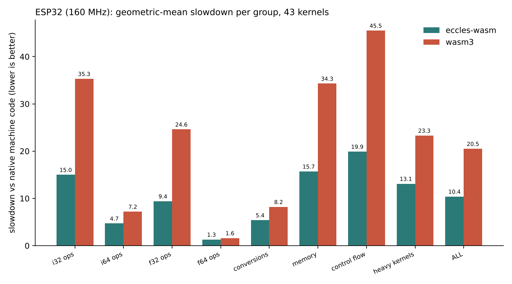

# 02 - Benchmark: eccles-wasm vs wasm3 vs native

43 kernels. The **same C source** is compiled twice: natively by the ESP-IDF toolchain, and to WebAssembly (`bench2.wasm`) which both interpreters run.
All three must return the same 64-bit checksum before any time is reported. Each kernel is calibrated to about 300 ms and the best of 2 runs is kept.

## Result (ESP32 rev 3.1, 160 MHz)

Slowdown versus native machine code, geometric mean (lower is better):

| Group | eccles-wasm | wasm3 |
|---|---:|---:|
| i32 ops | 15.0x | 35.3x |
| i64 ops | 4.7x | 7.2x |
| f32 ops | 9.4x | 24.6x |
| f64 ops | 1.3x | 1.6x |
| conversions | 5.4x | 8.2x |
| memory | 15.7x | 34.3x |
| control flow | 19.9x | 45.5x |
| heavy kernels | 13.1x | 23.3x |
| **All 43** | **10.4x** | **20.5x** |

eccles-wasm was faster on all 43 kernels, and every checksum was identical across native, eccles-wasm and wasm3. Raw log: [`logs/run-2026-11-14.log`](logs/run-2026-11-14.log). Per-kernel numbers: [`docs/per_kernel_table.md`](docs/per_kernel_table.md), [`docs/kernels.png`](docs/kernels.png).

### Things to keep in mind
* **wasm3:** its simple i32 loops ran at 80x native, far above its usual range, so treat its numbers as a lower bound on what wasm3 can do.
* On a PC (x86) the order was reversed: wasm3 was 1.4x faster than eccles-wasm. The two interpreters behave very differently on Xtensa, so do not carry x86 numbers over.
* f64 looks almost free (1.1-1.8x) because the ESP32 has no double-precision hardware: native code also runs doubles in software.
* `mem_bulk` is below 1.0x for both interpreters: `memory.fill`/`memory.copy` execute as one operation, while the native `memset`/`memcpy` loop is slower on this chip.
* eccles-wasm was built with `ECCLES_WASM_FUEL 0` (no per-call instruction budget) for its fastest loop.

## Kernels
`guest/src/kern2.inc` holds 35 per-operation micro benchmarks (i32/i64/f32/f64 add, mul, div, shift, bit count, sqrt, conversions, byte/word/random memory access, `memory.fill`/`memory.copy`, direct and indirect calls, recursion, `br_table`, locals, nested loops); `guest/src/kern.inc` holds the 8 heavy kernels (`i64mix`, `crc32`, `divrem`, `imatmul`, `sieve`, `sort`, `f64`, `f32`).
Each is a dependent chain with no undefined behaviour and returns a checksum. Floating point is built without fused multiply-add on both sides so results are bit-exact.
`./guest/build.sh` regenerates `wasm/bench2.wasm` byte for byte.

## Build and run
Open `firmware/` in PlatformIO, delete `.pio` and `sdkconfig.esp32dev`, build, upload, open the monitor at 115200. The run takes 2-4 minutes and stops by itself.
* `src/CMakeLists.txt` and `sdkconfig.defaults` are exactly as built; `src/wasm3/` is a copy of the wasm3 sources with the ESP32 settings given in `CMakeLists.txt`.
* `-DBENCH_TARGET_MS=300` and `-DBENCH_REPEATS=2` in `build_flags` change the run length.
