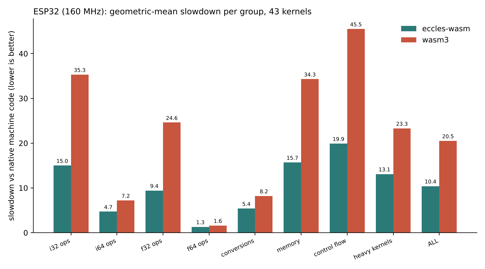

# Eccles WASM - hardware validation

Real-chip evidence for **v2.0.0**: a 4186-check conformance run and a 43-kernel speed benchmark against wasm3, both on a physical ESP32 (rev 3.1) with the logs kept next to the sources that produced them.

Two self-contained ESP32 projects that exercise the **eccles-wasm** WebAssembly runtime on real hardware.
Each project has the same four parts: the **guest** source that becomes WebAssembly, the **firmware** (PlatformIO / ESP-IDF host code),
the compiled **wasm** binaries, and the captured serial **logs**.

| | Project | What it proves | Result on an ESP32 |
|---|---|---|---|
| 1 | [`01-conformance-suite`](01-conformance-suite) | Correctness: arithmetic, traps, hardware privileges, atomics, threads, malformed input, instances | **4186 PASS, 0 FAIL** in 80 s ([log](01-conformance-suite/logs/run-2026-11-14.log)) |
| 2 | [`02-benchmark-vs-wasm3`](02-benchmark-vs-wasm3) | Speed: 43 kernels as native code, in eccles-wasm and in wasm3, with identical checksums | eccles-wasm **10.4×** slower than native, wasm3 **20.5×** |



## Layout

```
eccles-wasm-validation/
├── 01-conformance-suite/
│   ├── guest/       C sources + Python generators + build scripts that produce every test module
│   ├── firmware/    PlatformIO project (main.c, wasm.h, runtime copy, config)
│   ├── wasm/        15 modules (*.wasm) and wasm/edge-cases/ (51 hand-assembled modules), SHA256SUMS
│   └── logs/        serial output of the run (raw and ANSI-stripped)
└── 02-benchmark-vs-wasm3/
    ├── guest/       43 benchmark kernels (kern.inc, kern2.inc) + exact build command
    ├── firmware/    PlatformIO project: eccles-wasm + wasm3 + native harness
    ├── wasm/        bench2.wasm (19,489 bytes), SHA256SUMS
    ├── logs/        serial output of the run
    └── docs/        charts and the per-kernel table
```

## Reproduce
* **Firmware:** open `firmware/` in VS Code + PlatformIO (`espressif32@6.5.0`, board `esp32dev`, framework `espidf`). Delete `.pio` and `sdkconfig.esp32dev` after changing `sdkconfig.defaults`. Monitor at 115200 baud.
* **Wasm:** `guest/` needs clang with the `wasm32` target, `wasm-ld` and Python 3. Project 1: `./build_all.sh` then `python3 build_deliver.py` (writes `wasm.h`). Project 2: `./build.sh`.
* The `wasm.h` headers in `firmware/src` are generated from the binaries in `wasm/`; they are committed so the firmware builds without clang.

## Honest notes
* **Runtime copy:** each `firmware/src/eccles_wasm.[ch]` is the runtime exactly as it was compiled into that firmware and logged: an earlier snapshot of the release `src/` with the same public API. Its version string reads 1.0.0. For 01 it differs from `src/` only in comments, the version string and the optional `ECCLES_WASM_EXEC_IRAM` setting (off by default), so it behaves like the release. In 02 the interpreter loop sits in IRAM through a hand-written attribute, which the release now offers as `ECCLES_WASM_EXEC_IRAM` (that option also moves the dispatch table to internal RAM, so numbers from the release source may differ slightly). The release has its own host test suite (`make check`, `make wasm-threads`, differential fuzzing against Node's WebAssembly engine).
* Both firmwares were built and flashed on a real ESP32 by the repo owner; the logs here are from those runs. Before flashing, the sources were also compiled and run on a PC with stubbed ESP headers, which cannot exercise the hardware tests.
* Each `firmware/` folder is the project exactly as it was built for the log next to it. Nothing was updated or fixed afterwards, so the logs reproduce what the sources in this repo did. Known quirks of those runs are described in each project's README.
