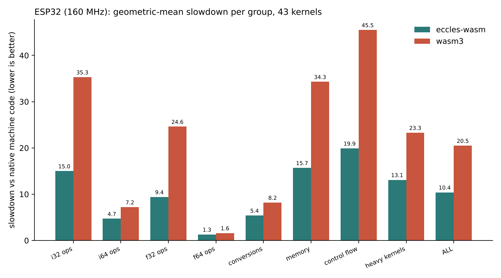
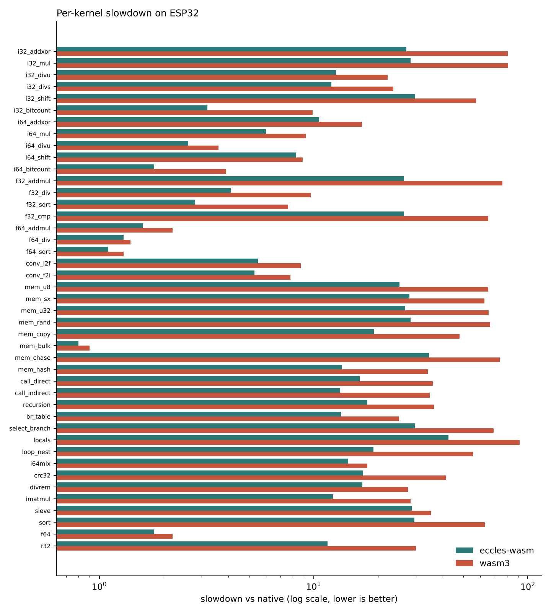

# Performance and Benchmarks

Measured on a **real ESP32** (rev 3.1, 160 MHz, ESP-IDF 5.1.2), not a simulator: 43 kernels, the same C source compiled once to native code and once to WebAssembly, run by Eccles WASM and by wasm3. Every kernel's 64-bit checksum had to match across all three before a time was reported.

## Headline

| | Slowdown vs native code (geometric mean of 43 kernels) |
|---|---:|
| **Eccles WASM** | **10.4x** |
| wasm3 | 20.5x |

Eccles WASM was faster than wasm3 on **all 43 kernels**, about **2x faster overall** on the same chip running the same module, and every result was identical to native.

## Per group

Slowdown versus native machine code, geometric mean (lower is better):

| Group | Kernels | Eccles WASM | wasm3 | Eccles WASM speedup over wasm3 |
|---|---:|---:|---:|---:|
| i32 ops | 6 | 15.0x | 35.3x | 2.3x |
| i64 ops | 5 | 4.7x | 7.2x | 1.5x |
| f32 ops | 4 | 9.4x | 24.6x | 2.6x |
| f64 ops | 3 | 1.3x | 1.6x | 1.2x |
| conversions | 2 | 5.4x | 8.2x | 1.5x |
| memory | 8 | 15.7x | 34.3x | 2.2x |
| control flow | 7 | 19.9x | 45.5x | 2.3x |
| heavy kernels | 8 | 13.1x | 23.3x | 1.8x |
| **All** | **43** | **10.4x** | **20.5x** | **2.0x** |

("Speedup" is the wasm3 slowdown divided by the Eccles WASM slowdown, from the log's numbers.)

## Heavy, real-world style kernels

Time to run the same work, microseconds (lower is better). Native is the same C compiled for the ESP32.

| Kernel | What it does | Native | Eccles WASM | wasm3 | Eccles vs native | wasm3 vs native |
|---|---|---:|---:|---:|---:|---:|
| `i64mix` | 64-bit arithmetic mix | 20,568 | 298,901 | 365,326 | 14.5x | 17.8x |
| `crc32` | CRC-32 over a buffer | 17,590 | 299,833 | 729,143 | 17.0x | 41.5x |
| `divrem` | integer divide and remainder | 19,648 | 331,528 | 542,638 | 16.9x | 27.6x |
| `imatmul` | integer matrix multiply | 24,296 | 298,567 | 688,802 | 12.3x | 28.4x |
| `sieve` | prime sieve | 8,431 | 242,208 | 297,157 | 28.7x | 35.2x |
| `sort` | sorting | 8,848 | 262,091 | 557,728 | 29.6x | 63.0x |
| `f64` | double-precision math | 162,483 | 285,722 | 361,295 | 1.8x | 2.2x |
| `f32` | single-precision math | 17,678 | 204,654 | 532,857 | 11.6x | 30.1x |

(Each kernel runs a calibrated number of iterations, about 300 ms for the WebAssembly runs, so the columns are for different amounts of work per row: compare the slowdown columns, not the raw times across rows.)

## Every one of the 43 kernels

| kernel | eccles-wasm | wasm3 |
|---|---:|---:|
| i32_addxor | 27.1× | 80.6× |
| i32_mul | 28.4× | 80.8× |
| i32_divu | 12.7× | 22.2× |
| i32_divs | 12.1× | 23.6× |
| i32_shift | 29.8× | 57.2× |
| i32_bitcount | 3.2× | 9.9× |
| i64_addxor | 10.6× | 16.8× |
| i64_mul | 6.0× | 9.2× |
| i64_divu | 2.6× | 3.6× |
| i64_shift | 8.3× | 8.9× |
| i64_bitcount | 1.8× | 3.9× |
| f32_addmul | 26.5× | 76.1× |
| f32_div | 4.1× | 9.7× |
| f32_sqrt | 2.8× | 7.6× |
| f32_cmp | 26.5× | 65.3× |
| f64_addmul | 1.6× | 2.2× |
| f64_div | 1.3× | 1.4× |
| f64_sqrt | 1.1× | 1.3× |
| conv_i2f | 5.5× | 8.7× |
| conv_f2i | 5.3× | 7.8× |
| mem_u8 | 25.2× | 65.4× |
| mem_sx | 28.0× | 62.7× |
| mem_u32 | 26.8× | 65.5× |
| mem_rand | 28.4× | 66.8× |
| mem_copy | 19.1× | 48.1× |
| mem_bulk | 0.8× | 0.9× |
| mem_chase | 34.5× | 74.0× |
| mem_hash | 13.6× | 34.1× |
| call_direct | 16.4× | 36.0× |
| call_indirect | 13.3× | 34.8× |
| recursion | 17.8× | 36.5× |
| br_table | 13.4× | 25.1× |
| select_branch | 29.7× | 69.1× |
| locals | 42.6× | 91.7× |
| loop_nest | 19.0× | 55.4× |
| i64mix | 14.5× | 17.8× |
| crc32 | 17.0× | 41.5× |
| divrem | 16.9× | 27.6× |
| imatmul | 12.3× | 28.4× |
| sieve | 28.7× | 35.2× |
| sort | 29.6× | 63.0× |
| f64 | 1.8× | 2.2× |
| f32 | 11.6× | 30.1× |

## How the benchmark was run

- **Chip:** ESP32 rev 3.1 at 160 MHz, ESP-IDF 5.1.2 (PlatformIO `espressif32@6.5.0`), `-O2` and `CONFIG_COMPILER_OPTIMIZATION_PERF=y`.
- **Module:** `bench2.wasm`, 19,489 bytes, built with `clang --target=wasm32` from one C source that is also compiled natively.
- **Kernels:** 35 micro-benchmarks (i32, i64, f32, f64 add/mul/div/shift/bit-count/sqrt, conversions, memory access patterns, `memory.fill`/`memory.copy`, direct and indirect calls, recursion, `br_table`, locals, nested loops) plus 8 heavy kernels (`i64mix`, `crc32`, `divrem`, `imatmul`, `sieve`, `sort`, `f64`, `f32`).
- **Fairness:** each kernel is a dependent chain with no undefined behaviour and returns a 64-bit checksum. Floating point is built without fused multiply-add on both sides so results are bit-exact. Each kernel is calibrated to about 300 ms; best of 2 runs.
- **Eccles WASM build:** `ECCLES_WASM_FUEL 0` (no per-call instruction budget, the fastest loop), `ECCLES_WASM_YIELD_INTERVAL 0`, with the interpreter loop running from internal RAM (IRAM). In the release source that is `ECCLES_WASM_EXEC_IRAM 1`.
- **wasm3 build:** its hot operations are also placed in IRAM.
- The raw log is [`validation/02-benchmark-vs-wasm3/logs/run-2026-11-14.log`](https://github.com/igwe-starking/eccles-wasm/blob/main/validation/02-benchmark-vs-wasm3/logs/run-2026-11-14.log) and the firmware that produced it is in the same folder.

## Reading the numbers honestly

- **wasm3's simple i32 loops ran at about 80x native**, well above its usual range, so treat wasm3's numbers as a lower bound on what wasm3 can do on this chip.
- **On a PC (x86) the order was reversed:** wasm3 was 1.4x faster than Eccles WASM there. The two interpreters behave very differently on the Xtensa core, so do not carry x86 numbers over to your chip, and measure on yours.
- **f64 looks almost free** (1.1x to 1.8x) because the ESP32 has no double-precision hardware: native code also runs doubles in software.
- **`mem_bulk` is under 1.0x** for both interpreters: `memory.fill` and `memory.copy` execute as one operation, while the native `memset`/`memcpy` loop is slower on this chip.
- The default build (`FUEL 1`) is a little slower than the benchmark build. Set `ECCLES_WASM_FUEL 1` and measure if you need that number.

## What this means for your project

A 10x slowdown versus native code is still plenty for the work a plugin does on a microcontroller: reading sensors, applying thresholds, running a control loop at tens of Hz, parsing a protocol, driving a state machine. A CRC-32 kernel over a buffer ran in about 17 times the native time; native takes 17.6 ms for that work, so the interpreter takes about 0.3 s. Put heavy inner loops (FFT, large DSP, crypto) in native C and call them as [host functions](Host-Functions); keep the logic in WebAssembly.

## Measure on your own chip

The benchmark firmware is a PlatformIO project: open `validation/02-benchmark-vs-wasm3/firmware/` in VS Code with PlatformIO, delete `.pio` and `sdkconfig.esp32dev`, build, upload, and open the monitor at 115200. It runs for 2 to 4 minutes and stops by itself. Tune with `-DBENCH_TARGET_MS=300 -DBENCH_REPEATS=2` in `build_flags`. See [Validation](Validation) and [Speed Tuning](Speed-Tuning).
